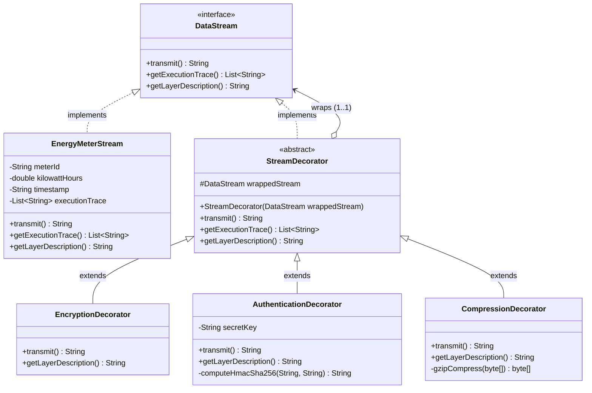
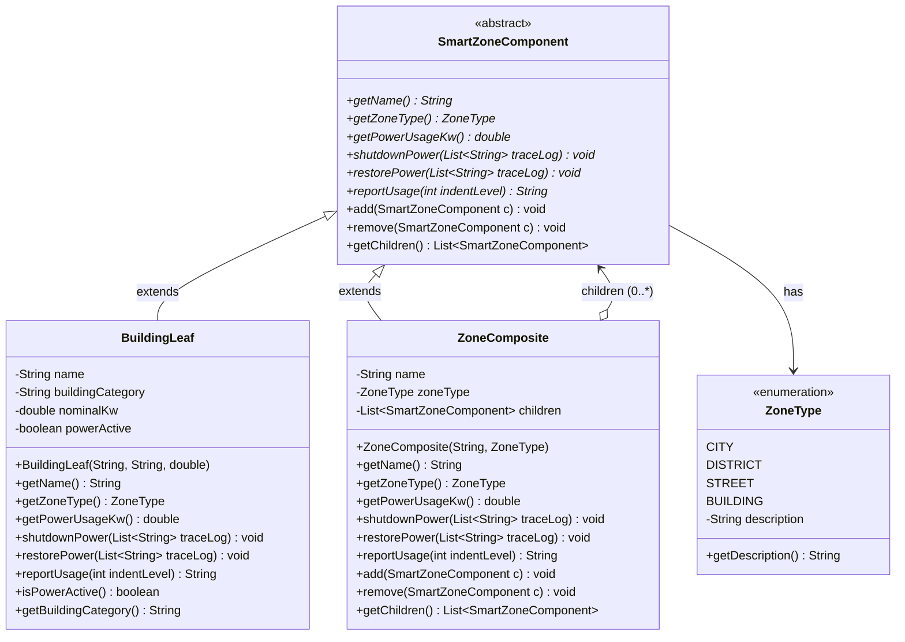
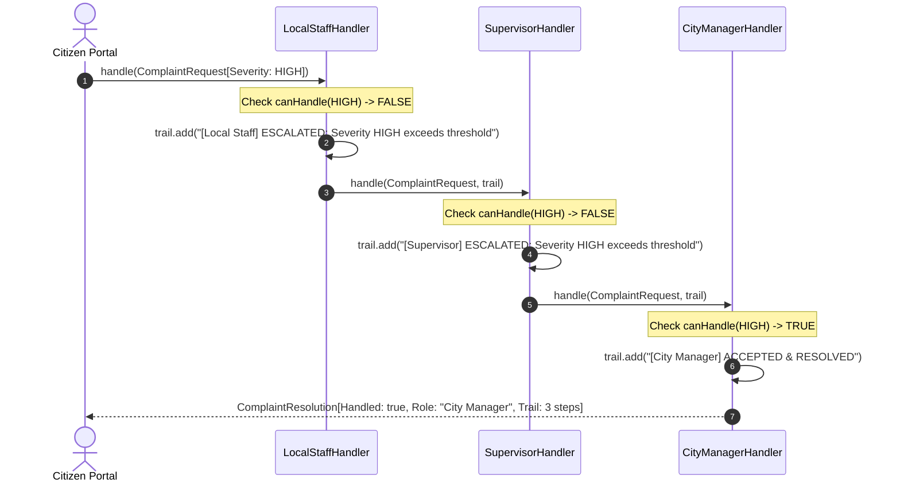
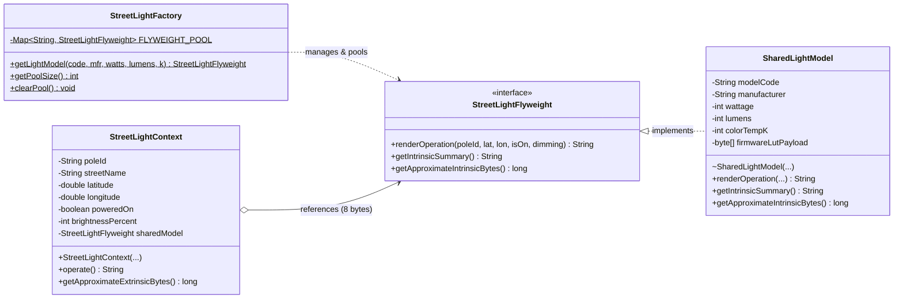
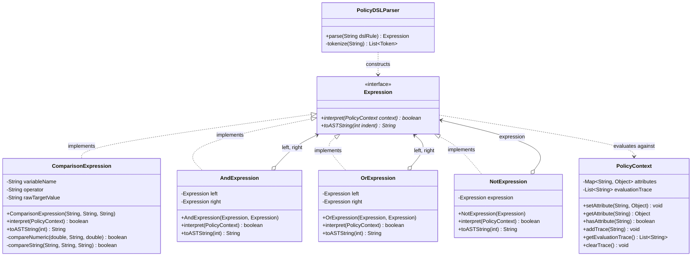

# SmartCity360 – A Smart City Management Platform
## Comprehensive Academic Technical Report & Architectural Specification
**Course Module:** Object Oriented Design Patterns (OODP II)  
**Enterprise Entity:** UrbanTech Solutions  
**Target Environment:** Java 17 LTS, Apache Maven, FlatLaf 3.4, JUnit 5.10.2  
**Author:** Principal Java Systems Architect  
**Submission Date:** Academic Term 2026  

---

## Executive Summary

**SmartCity360** is an enterprise-grade, integrated digital management platform engineered by UrbanTech Solutions to orchestrate next-generation municipal infrastructure. Modern smart cities represent cyber-physical ecosystems comprising distributed energy grids, multi-tiered administrative zones, continuous citizen feedback pipelines, high-density IoT lighting grids, and dynamic automated policy enforcement frameworks.

To manage this scale, maintainability, extensibility, and resource efficiency, SmartCity360 applies five classic **Gang of Four (GoF)** design patterns:
1. **Part A: Decorator Pattern** – Dynamic, layered security wrappers (Encryption, Authentication, Compression) for smart energy meter telemetry streams.
2. **Part B: Composite Pattern** – Hierarchical administrative and infrastructural representation (City $\rightarrow$ District $\rightarrow$ Street $\rightarrow$ Building) enabling uniform, recursive operational control.
3. **Part C: Chain of Responsibility Pattern** – Decoupled, dynamic escalation of municipal citizen complaints across municipal authority tiers with runtime bypass capabilities.
4. **Part D: Flyweight Pattern** – High-density object pooling separating intrinsic optical/hardware profiles from extrinsic geographic pole coordinates, achieving $> 95\%$ heap memory conservation.
5. **Part E: Interpreter Pattern** – Domain-Specific Language (mini-DSL) parser and Abstract Syntax Tree (AST) evaluator for dynamic real-time municipal policy enforcement.

---

# Part A – Dynamic Security Wrappers for Data Streams (15 Marks)

### Context & Problem Statement
Energy meters across SmartCity360 transmit continuous telemetry streams comprising meter identifiers, kilowatt-hour (kWh) readings, and ISO-8601 timestamps. To protect this grid telemetry against interception, tampering, and transmission saturation across mesh networks, the data payload must be dynamically wrapped with cryptographic security layers (AES-256 encryption, HMAC-SHA256 signature authentication) and bandwidth optimization (GZIP compression). Crucially, these security layers must be combined in arbitrary configurations and sequences at runtime without modifying the core energy meter data stream component.

---

### Question 1: Identification and Justification of Design Pattern (3 Marks)

#### Selected Pattern
**The Gang of Four Decorator Pattern (Structural Pattern)**.

#### Architectural Justification
In object-oriented software engineering, attaching supplemental responsibilities to an object can be achieved through two primary mechanisms: static class inheritance or dynamic object composition.

If class inheritance were utilized, supporting arbitrary combinations of $N$ security features (where $N = 3$: Encryption, Authentication, Compression) would trigger a **combinatorial subclass explosion**:
$$\text{Number of Subclasses} = \sum_{k=1}^{N} \frac{N!}{(N-k)!} = 3 + 6 + 6 = 15 \text{ subclasses}$$
If ordering matters (e.g., `EncryptedThenCompressed` vs `CompressedThenEncrypted`), static inheritance becomes entirely intractable, fragile, and rigid.

The **GoF Decorator Pattern** resolves this problem by following the core object-oriented principle: **"Favor object composition over class inheritance"**. By implementing a common interface (`DataStream`), decorators wrap the core telemetry component (`EnergyMeterStream`) transparently. The client interacts exclusively with the `DataStream` contract, completely oblivious to whether it communicates with a naked meter stream or a deeply nested pipeline of decorators.

---

### Question 2: Mechanism of Flexible & Layered Enhancements (4 Marks)

The Decorator pattern achieves flexible and layered functional enhancement through **recursive delegation** and **conformance to a uniform interface**:



#### Operational Workflow:
1. **Uniform Interface:** `DataStream` establishes the contract: `transmit()`, `getExecutionTrace()`, and `getLayerDescription()`.
2. **Concrete Component:** `EnergyMeterStream` implements `DataStream`, emitting raw telemetry in JSON format:
   `{"meterId":"MTR-104","kWh":42.85,"ts":"2026-11-08T15:45:00Z"}`.
3. **Abstract Decorator:** `StreamDecorator` maintains a reference `protected final DataStream wrappedStream;` and forwards default operations directly to it.
4. **Dynamic Stacking at Runtime:**
   ```java
   DataStream securedPipeline = new CompressionDecorator(
       new AuthenticationDecorator(
           new EncryptionDecorator(
               new EnergyMeterStream("MTR-104", 42.85, Instant.now().toString())
           )
       )
   );
   String wirePayload = securedPipeline.transmit();
   ```
5. **Execution Order:** When `transmit()` is invoked on `securedPipeline`, execution flows from outermost to innermost:
   - `CompressionDecorator.transmit()` invokes `wrappedStream.transmit()`.
   - `AuthenticationDecorator.transmit()` invokes `wrappedStream.transmit()`.
   - `EncryptionDecorator.transmit()` invokes `wrappedStream.transmit()`.
   - `EnergyMeterStream.transmit()` generates the raw telemetry JSON and logs to trace.
   - `EncryptionDecorator` encrypts the JSON (`ENC[AES256](...)`) and appends its trace.
   - `AuthenticationDecorator` calculates the HMAC-SHA256 signature (`AUTH[HMAC=<hash>]|...`) and appends its trace.
   - `CompressionDecorator` compresses the signed payload with GZIP (`COMP[GZIP,ratio=XX%](...)`) and appends its trace.

---

### Question 3: Long-Term Benefits in Reusability and System Extensibility (8 Marks)

The Decorator pattern yields substantial long-term architectural benefits for municipal infrastructure software:

#### 1. Adherence to SOLID Principles
- **Single Responsibility Principle (SRP):** Each decorator class encapsulates exactly one computational responsibility:
  - `EncryptionDecorator`: Encapsulates AES-256 cipher transformation.
  - `AuthenticationDecorator`: Encapsulates HMAC-SHA256 token generation and cryptographic integrity verification.
  - `CompressionDecorator`: Encapsulates GZIP stream compression and bandwidth savings calculations.
  - `EnergyMeterStream`: Focuses exclusively on raw telemetry data modeling.
- **Open/Closed Principle (OCP):** The system is **open for extension, but closed for modification**. If municipal security regulations demand adding an `AnonymizationDecorator` or a `QuantumResistantSignatureDecorator`, developers introduce a new subclass extending `StreamDecorator` without modifying a single line of `EnergyMeterStream` or existing decorators.
- **Liskov Substitution Principle (LSP):** Any concrete decorator is completely substitutable wherever a `DataStream` is expected.

#### 2. Reusability Across Diverse Telemetry Sources
Because `StreamDecorator` couples exclusively to the abstract interface `DataStream`, the same security decorators can wrap other IoT telemetry streams without duplication (e.g., `WaterPressureStream`, `AirQualityStream`, `TrafficSensorStream`).

#### 3. Granular Dynamic Configuration
Security wrappers can be toggled per transmission depending on grid threat conditions, device compute capacity, and bandwidth availability (e.g., edge battery-powered sensors may omit encryption to save energy, while high-voltage substations employ triple-layer security).

---

# Part B – Hierarchical Structure of Smart Zones (15 Marks)

### Context & Problem Statement
Smart cities are structured as multi-tiered administrative and geographic hierarchies:
$$\text{City} \longrightarrow \text{Districts} \longrightarrow \text{Streets/Sectors} \longrightarrow \text{Buildings/Facilities}$$
Operations such as emergency power shutdowns (`shutdownPower`), grid restoration (`restorePower`), and consumption auditing (`reportUsage`) must execute uniformly across all levels of this hierarchy. An operator must be able to shut down an entire district, an individual street, or a single hospital building using identical method calls.

---

### Question 1: Identification and Justification of Design Pattern (3 Marks)

#### Selected Pattern
**The Gang of Four Composite Pattern (Structural Pattern)**.

#### Architectural Justification
In a naive design without the Composite pattern, client code would be forced to maintain distinct collections for cities, districts, streets, and individual buildings:
```java
// Anti-Pattern: Primitive Obsession & Type-Switching
if (target instanceof City) { ... }
else if (target instanceof District) { ... }
else if (target instanceof Building) { ... }
```
This violates the Open/Closed Principle and couples high-level municipal command dashboards to specific administrative nesting depths.

The **GoF Composite Pattern** solves this by organizing objects into tree structures to represent part-whole hierarchies. Composite allows clients to treat individual objects (leaves) and compositions of objects (composites) **uniformly**.

---

### Question 2: Complete UML Class Diagram (4 Marks)



---

### Question 3: Management of Large and Growing City Infrastructure (8 Marks)

#### 1. Recursive Polymorphic Uniformity
Clients invoke operations on `SmartZoneComponent` without checking whether the receiver is a single leaf (`BuildingLeaf`) or a composite containing thousands of nodes (`ZoneComposite`):
- **Power Aggregation:** When `getPowerUsageKw()` is called on `MetroSmartCity`, it recursively iterates through district composites, which iterate through street composites, which sum the active kW of `BuildingLeaf` nodes:
  $$\text{Total Power} = \sum_{i=1}^{\text{children}} \text{child}_i.\text{getPowerUsageKw}()$$
- **Cascading Commands:** Calling `shutdownPower(traceLog)` on `North District` logs the district broadcast and propagates down to all constituent streets and buildings, disconnecting circuits without client loops.

#### 2. Scalability for Urban Expansion
As smart cities construct new sectors, districts, or smart micro-grids, the composite hierarchy accommodates arbitrary expansion:
- New leaves (`BuildingLeaf`) and composites (`ZoneComposite`) can be attached at runtime via `add(SmartZoneComponent)`.
- Client systems (such as the Swing GUI and automated grid balancers) require zero code changes or recompilation when new administrative tiers or facilities are introduced.

#### 3. The Transparency vs. Safety Trade-Off
In the classic GoF specification, there is a fundamental design tension between **Transparency** and **Safety**:
- **Transparency Approach:** Define child-management methods (`add`, `remove`, `getChildren`) in the root component `SmartZoneComponent`. This allows leaves and composites to be treated identically, but risks runtime errors if a client attempts to add a child to a leaf.
- **Safety Approach:** Declare child-management methods exclusively in `ZoneComposite`. This prevents clients from calling `add` on leaves at compile-time, but sacrifices uniformity because clients must downcast components.

**UrbanTech Solutions Design Decision:** SmartCity360 implements the **Transparency-focused pattern with safe default implementations**:
```java
public void add(SmartZoneComponent component) {
    throw new UnsupportedOperationException("Leaf components cannot add child nodes.");
}
```
This preserves uniform polymorphic assignment while delivering explicit fail-fast semantics if an invalid hierarchy mutation is attempted.

---

# Part C – Escalation of Citizen Complaints (15 Marks)

### Context & Problem Statement
Municipal residents submit thousands of complaints daily ranging from minor sanitation requests (overflowing litter bins) to district-wide service outages (burst water mains) and catastrophic emergencies (power grid substation explosions). The system must route requests dynamically through appropriate municipal authority tiers (Local Field Staff $\rightarrow$ District Operations Supervisor $\rightarrow$ Executive City Manager) based on incident severity, while maintaining a transparent audit trail and enabling runtime handler bypass when specific departments are offline.

---

### Question 1: Identification and Justification of Design Pattern (3 Marks)

#### Selected Pattern
**The Gang of Four Chain of Responsibility Pattern (Behavioral Pattern)**.

#### Architectural Justification
A procedural alternative to complaint handling relies on rigid conditional blocks:
```java
// Anti-Pattern: Hardcoded Procedural Routing
if (severity == LOW) localStaff.handle(req);
else if (severity == MEDIUM) supervisor.handle(req);
else if (severity == HIGH) cityManager.handle(req);
```
This tightly couples the complaint submission portal to every concrete municipal handler class, prevents dynamic reordering or toggling of handlers at runtime, and makes adding new authority tiers (e.g., Regional Environmental Agency) hazardous.

The **GoF Chain of Responsibility Pattern** decouples the sender of a request from its potential receivers by giving more than one object a chance to handle the request. The request is passed along a chain of handler objects until an authority processes it or the chain is exhausted.

---

### Question 2: Mechanism of Decoupled Request Handling (4 Marks)

Decoupling is achieved through an abstract handler specification, successor encapsulation, and an immutable request model:



#### Key Decoupling Components:
1. **Immutable Request Model:** `ComplaintRequest` encapsulates complaint details, ID, citizen name, and `SeverityLevel` (`LOW`, `MEDIUM`, `HIGH`, `EXTREME`).
2. **Template Method Traversal:** `ComplaintHandler.handle(ComplaintRequest request, List<String> trail)` defines the universal traversal algorithm:
   ```java
   if (active && canHandle(request)) {
       trail.add(String.format("[%s] ACCEPTED: Complaint #%s falls within authority.", handlerName, request.getComplaintId()));
       return process(request, trail);
   }
   if (!active) {
       trail.add(String.format("[%s] BYPASSED: Handler is OFFLINE.", handlerName));
   } else {
       trail.add(String.format("[%s] ESCALATED: Severity %s exceeds threshold.", handlerName, request.getSeverity()));
   }
   if (nextHandler != null) {
       return nextHandler.handle(request, trail);
   }
   return new ComplaintResolution(false, "UNRESOLVED / EXTERNAL ESCALATION", "Forwarded to State Bureau.", trail);
   ```
3. **Fluent Chain Configuration:** Handlers are assembled dynamically via fluent method chaining:
   `localStaff.setNextHandler(supervisor).setNextHandler(cityManager);`

---

### Question 3: Evaluation of Benefits and Drawbacks (8 Marks)

| Architectural Dimension | Benefits | Drawbacks & Mitigation in SmartCity360 |
| :--- | :--- | :--- |
| **Coupling & Modularity** | Citizen portal has zero knowledge of concrete municipal handlers; it only interacts with the head of the `ComplaintHandler` chain. | Risk of fragmented responsibility. Mitigated by explicit handler names and well-defined `SeverityLevel` boundaries. |
| **Dynamic Flexibility** | Handlers can be added, removed, re-ordered, or toggled (`setActive(false)`) at runtime without altering client code. | Request might reach the end of the chain without being processed (unhandled request). Mitigated by our explicit `[CHAIN-EXHAUSTED]` fallback returning `ComplaintResolution(false, ...)`. |
| **Traceability & Auditing** | High traceability: chronological `escalationTrail` records every handler evaluated, bypassed, escalated, or resolved. | Deep chains can incur debugging overhead and execution stack depth. Mitigated by keeping municipal chains lean (3–5 tiers) and linear. |
| **Resilience & Fault Tolerance** | If a department goes offline (e.g. `supervisor.setActive(false)`), the chain automatically bypasses it to the next tier. | If all handlers are disabled, requests fail immediately. Mitigated by municipal fail-safe logging to `ExecutionLogBus`. |

---

# Part D – Efficient Management of Smart Street Lights (15 Marks)

### Context & Problem Statement
SmartCity360 operates over **50,000 to 100,000 smart streetlights** installed along city thoroughfares. While each streetlight occupies a unique geographic location (latitude, longitude, pole identifier) and operates at a specific runtime dimming level, their underlying hardware configuration—wattage, luminous flux, correlated color temperature, physical housing dimensions, and a **2048-byte photometric calibration lookup table (LUT)**—is identical across four standardized municipal lighting models. Storing duplicate copies of this heavy hardware specification for every physical pole causes severe JVM heap memory exhaustion.

---

### Question 1: Identification and Justification of Design Pattern (3 Marks)

#### Selected Pattern
**The Gang of Four Flyweight Pattern (Structural Pattern)**.

#### Architectural Justification
In a naive object model, instantiating 100,000 complete streetlight objects creates 100,000 duplicate copies of the 2 KB photometric LUT array, metadata strings, and optical calibration curves.

The **GoF Flyweight Pattern** optimizes memory consumption by sharing common, immutable state among multiple objects. Instead of storing redundant state in every instance, the Flyweight pattern partitions object state into:
1. **Intrinsic State:** Shared, invariant, and context-independent data stored inside the flyweight object.
2. **Extrinsic State:** Unique, mutable, and context-dependent data stored outside the flyweight and passed to flyweight methods when operations are requested.

---

### Question 2: Handling Shared (Intrinsic) vs. Unique (Extrinsic) Properties (4 Marks)



#### Detailed State Partitioning:

| Attribute | State Classification | Storage Location | Mutability | Memory Impact |
| :--- | :--- | :--- | :--- | :--- |
| **Model Code** (`modelCode`) | **Intrinsic** | `SharedLightModel` | Immutable | Shared once per hardware model |
| **Manufacturer** (`manufacturer`) | **Intrinsic** | `SharedLightModel` | Immutable | Shared once per hardware model |
| **Wattage, Lumens, CCT** | **Intrinsic** | `SharedLightModel` | Immutable | Shared once per hardware model |
| **Photometric LUT Profile** (`byte[2048]`) | **Intrinsic** | `SharedLightModel` | Immutable | Heavy array allocated **only 4 times** |
| **Pole ID** (`poleId`) | **Extrinsic** | `StreetLightContext` | Unique | Stored per pole context |
| **Geographic Coordinates** (`lat, lon`) | **Extrinsic** | `StreetLightContext` | Unique | 16 bytes per pole context |
| **Power State & Dimming** (`isOn, dimming`) | **Extrinsic** | `StreetLightContext` | Mutable | 5 bytes per pole context |
| **Model Reference** (`sharedModel`) | **Pointer** | `StreetLightContext` | Immutable | Single 8-byte reference pointer |

Factory encapsulation guarantees that `SharedLightModel` constructors are package-private, enforcing access through `StreetLightFactory.getLightModel(...)`.

---

### Question 3: Quantitative Memory Footprint Analysis (8 Marks)

Let:
- $N$ be the total number of physical streetlight installations across the city.
- $K$ be the number of unique hardware streetlight models ($K = 4$).
- $S_{\text{intrinsic}}$ be the heap memory consumed by one shared intrinsic model ($\approx 2,400\text{ bytes}$).
- $S_{\text{extrinsic}}$ be the heap memory consumed by one extrinsic pole context ($\approx 112\text{ bytes}$).

#### Theoretical Formulation:
$$\text{Memory}_{\text{Unoptimized}} = N \times (S_{\text{intrinsic}} + S_{\text{extrinsic}})$$
$$\text{Memory}_{\text{Flyweight}} = (K \times S_{\text{intrinsic}}) + (N \times S_{\text{extrinsic}})$$
$$\text{Memory Saved (\%)} = \left( 1 - \frac{\text{Memory}_{\text{Flyweight}}}{\text{Memory}_{\text{Unoptimized}}} \right) \times 100\%$$

#### Empirical Benchmark Calculations across Scales:

| Metric | $N = 10,000$ Poles | $N = 50,000$ Poles | $N = 100,000$ Poles |
| :--- | :---: | :---: | :---: |
| **Unique Models ($K$)** | 4 models | 4 models | 4 models |
| **Unoptimized Heap (Bytes)** | $25,120,000\text{ B}$ | $125,600,000\text{ B}$ | $251,200,000\text{ B}$ |
| **Unoptimized Heap (MB)** | **$23.96\text{ MB}$** | **$119.78\text{ MB}$** | **$239.56\text{ MB}$** |
| **Flyweight Heap (Bytes)** | $1,129,600\text{ B}$ | $5,609,600\text{ B}$ | $11,209,600\text{ B}$ |
| **Flyweight Heap (MB)** | **$1.08\text{ MB}$** | **$5.35\text{ MB}$** | **$10.69\text{ MB}$** |
| **Heap Memory Conserved (MB)** | **$22.88\text{ MB}$** | **$114.43\text{ MB}$** | **$228.87\text{ MB}$** |
| **RAM Conservation Rate** | **$95.50\%$** | **$95.53\%$** | **$95.54\%$** |

#### JVM Garbage Collection & Runtime Impact:
1. **Garbage Collection Pressure:** Instantiating 100,000 unshared 2 KB arrays consumes a quarter gigabyte of contiguous heap memory, triggering frequent Stop-The-World (STW) Young Generation allocations and Major GC pauses.
2. **Cache Locality:** With only 4 `SharedLightModel` instances in memory, CPU L1/L2 caches retain the shared flyweights hot during bulk iteration, dramatically increasing rendering and command dispatch throughput.

---

# Part E – Interpreting City Policies Defined in DSL (15 Marks)

### Context & Problem Statement
Smart city operational regulations—such as residential noise limits, school zone speed limits, overnight heavy vehicle curfews, and commercial parking overstay restrictions—change frequently based on municipal council bylaws. Hardcoding these rules into application logic requires constant recompilation, code commits, and testing cycles. SmartCity360 requires a dynamic Domain-Specific Language (mini-DSL) parser and Abstract Syntax Tree (AST) evaluator that parses rule strings and evaluates them against live city telemetry in real time.

---

### Question 1: Identification and Justification of Design Pattern (3 Marks)

#### Selected Pattern
**The Gang of Four Interpreter Pattern (Behavioral Pattern)**.

#### Architectural Justification
When a domain problem occurs repeatedly and can be characterized as sentences in a mini-language, defining a formal grammar and building an interpreter is the most robust software engineering technique.

The **GoF Interpreter Pattern** defines a grammatical representation for a language along with an interpreter that uses the representation to interpret sentences in the language. Each grammar rule is represented by an object-oriented class (terminal or non-terminal expression), allowing policies to be modeled as an executable Abstract Syntax Tree (AST).

---

### Question 2: Complete UML Class Diagram (4 Marks)



---

### Question 3: Critical Assessment of Suitability for Rule Updates and Extensibility (8 Marks)

#### 1. Extensibility & Ease of Rule Updates
- **Dynamic Bylaw Adjustments Without Recompilation:** Municipal administrators update rules at runtime simply by inputting new DSL strings:
  `ZONE == 'RESIDENTIAL' AND DECIBELS > 55`
  `ZONE == 'SCHOOL_ZONE' AND SPEED_KMH > 30`
  `TIME_HOUR >= 22 OR TIME_HOUR <= 6 AND VEHICLE == 'HEAVY_TRUCK'`
  `ZONE == 'COMMERCIAL' AND PARKING_MINS > 120 AND NOT PERMIT == 'VALID'`
- **Adding New Operations via AST Classes:** Extending the language (e.g., adding an `InExpression` for set membership `ZONE IN ('ZONE_A', 'ZONE_B')`) is straightforward: implement a new `InExpression` class implementing `Expression`. The existing AST nodes (`AndExpression`, `OrExpression`, `NotExpression`) remain completely untouched, upholding the **Open/Closed Principle**.

#### 2. Clear Evaluation Traceability
Because each AST node controls its own `interpret(PolicyContext)` method, every step of the evaluation records human-readable audit messages into `context.getEvaluationTrace()`:
```
[Terminal] ZONE (RESIDENTIAL) == 'RESIDENTIAL' -> true
[Terminal] DECIBELS (68.0) > 55 -> true
[NonTerminal: AND] (true AND true) -> true
```
This guarantees explainable AI/policy enforcement during municipal dispute resolution and administrative appeals.

#### 3. Limitations and When NOT to Use the Interpreter Pattern
While the Interpreter pattern excels for mini-languages with small grammars, it possesses notable architectural trade-offs:
- **Grammar Complexity Ceiling:** For large, complex programming languages with hundreds of production rules, maintaining an object-oriented class per grammar rule becomes unmaintainable. In such cases, parser generators (like ANTLR, Lex/Yacc) are preferred.
- **Deep AST Call Stacks:** Deeply nested logical expressions result in recursive method calls across AST nodes, which can impact performance if evaluated over millions of events per second.
- **Suitability Verdict for SmartCity360:** For municipal policy rules—which typically consist of 3 to 10 logical operators and terminal comparisons—the GoF Interpreter pattern is the optimal architectural choice, combining dynamic rule updates with zero external dependencies and total evaluation explainability.

---

# Part F – Integrated Architecture, SOLID Alignment & Synthesis (10 Marks)

### Master Integrated System Architecture

The five GoF patterns operate synergistically within SmartCity360's multi-tier architecture:

```mermaid
graph TD
    subgraph UI ["Swing GUI Presentation Tier (FlatLaf)"]
        Frame[SmartCityDashboardFrame]
        TabA[PartADecoratorPanel]
        TabB[PartBCompositePanel]
        TabC[PartCChainPanel]
        TabD[PartDFlyweightPanel]
        TabE[PartEInterpreterPanel]
        Console[Master Execution Trace Console]
        LogBus[ExecutionLogBus]
    end

    subgraph Domain ["Pure GoF Pattern Domain Modules"]
        subgraph PartA ["Part A: Decorator Pattern"]
            DS[DataStream]
            EMS[EnergyMeterStream]
            SD[StreamDecorator]
            ED[EncryptionDecorator]
            AD[AuthenticationDecorator]
            CD[CompressionDecorator]
        end

        subgraph PartB ["Part B: Composite Pattern"]
            SZC[SmartZoneComponent]
            ZC[ZoneComposite]
            BL[BuildingLeaf]
        end

        subgraph PartC ["Part C: Chain of Responsibility Pattern"]
            CH[ComplaintHandler]
            LSH[LocalStaffHandler]
            SH[SupervisorHandler]
            CMH[CityManagerHandler]
        end

        subgraph PartD ["Part D: Flyweight Pattern"]
            SLF[StreetLightFlyweight]
            SLFac[StreetLightFactory]
            SLM[SharedLightModel]
            SLC[StreetLightContext]
            BMS[MemoryBenchmarkService]
        end

        subgraph PartE ["Part E: Interpreter Pattern"]
            PC[PolicyContext]
            EXP[Expression]
            PARSER[PolicyDSLParser]
        end
    end

    Frame --> TabA
    Frame --> TabB
    Frame --> TabC
    Frame --> TabD
    Frame --> TabE
    Frame --> Console
    LogBus -.-> Console

    TabA --> DS
    TabB --> SZC
    TabC --> CH
    TabD --> SLFac
    TabD --> BMS
    TabE --> PARSER
    TabE --> PC

    Domain -.-> LogBus
```



---

### SOLID Principles Alignment Matrix

| SOLID Principle | SmartCity360 Architectural Realization | Pattern Involved |
| :--- | :--- | :--- |
| **S – Single Responsibility** | Every decorator class isolates a single security transformation; each complaint handler handles only its designated authority level; `SharedLightModel` handles only intrinsic optical physics. | Decorator, Chain of Responsibility, Flyweight |
| **O – Open/Closed Principle** | New security decorators, new zone hierarchy levels, new escalation tiers, and new AST expressions can be added without modifying existing tested code. | All 5 GoF Patterns |
| **L – Liskov Substitution** | Any `StreamDecorator` can substitute for `DataStream`; `ZoneComposite` and `BuildingLeaf` seamlessly substitute for `SmartZoneComponent`; any expression node implements `Expression`. | Decorator, Composite, Interpreter |
| **I – Interface Segregation** | Interfaces (`DataStream`, `StreetLightFlyweight`, `Expression`) are lean, focused, and free of extraneous client requirements. | Decorator, Flyweight, Interpreter |
| **D – Dependency Inversion** | High-level modules depend on abstractions (`DataStream`, `SmartZoneComponent`, `ComplaintHandler`, `Expression`), never on concrete low-level implementations. | All 5 GoF Patterns |

---

### Build, Verification, and Packaging Instructions

#### Prerequisites:
- Java SE Development Kit 17+ (`javac -version`)
- Apache Maven 3.8+ (`mvn -version`)

#### 1. Compile All Domain & UI Source Files:
```powershell
mvn clean compile
```

#### 2. Execute Full JUnit 5 Automated Verification Suite:
```powershell
mvn test
```
*Expected Result:* 31 tests executed across all 5 design patterns and GUI integration, with 0 failures and 0 errors.

#### 3. Launch Interactive FlatLaf Swing Application:
```powershell
mvn exec:java
```

#### 4. Package Self-Contained Executable Fat JAR:
```powershell
mvn package
java -jar target/smartcity360-1.0.0.jar
```

---
*End of SmartCity360 Academic Final Report.*
