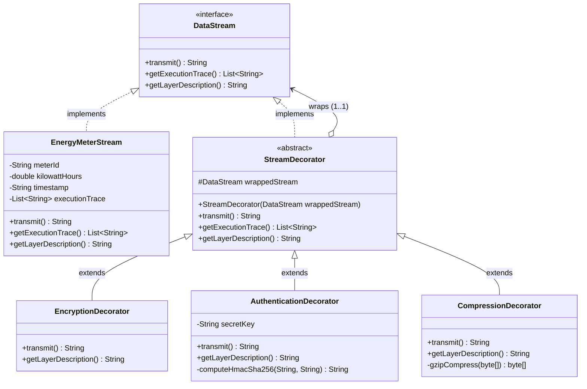
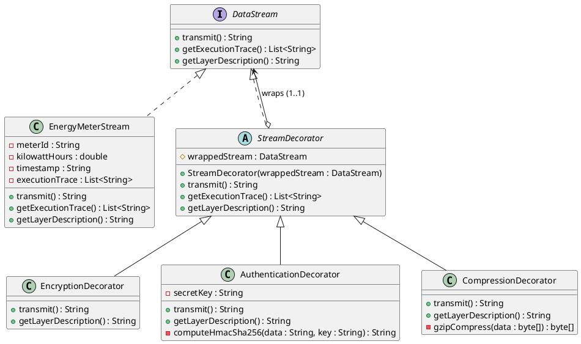
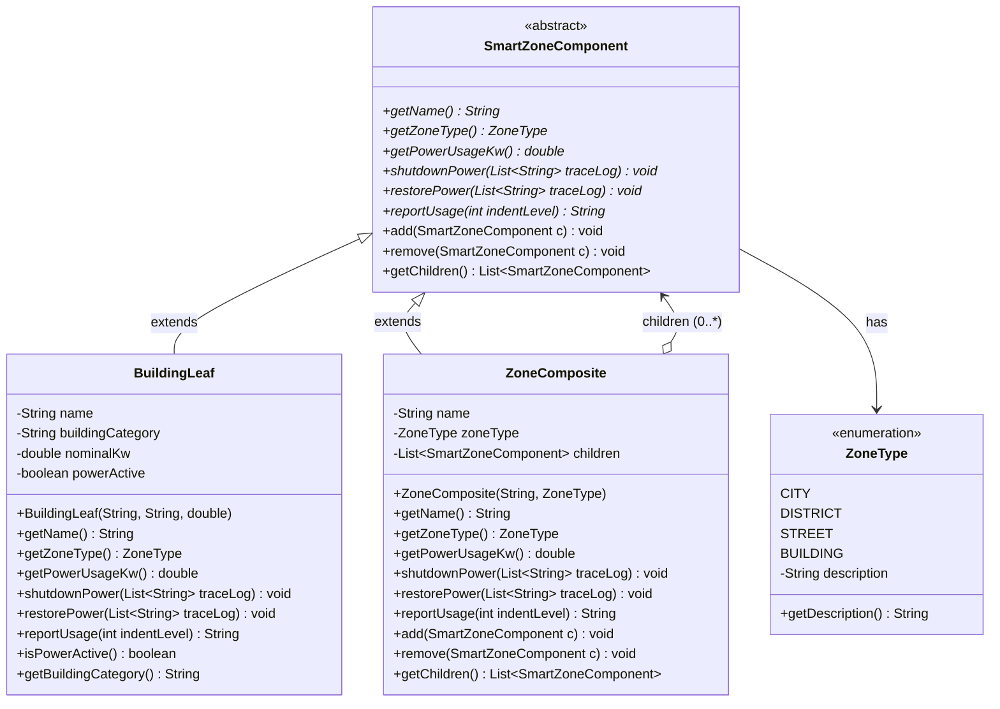
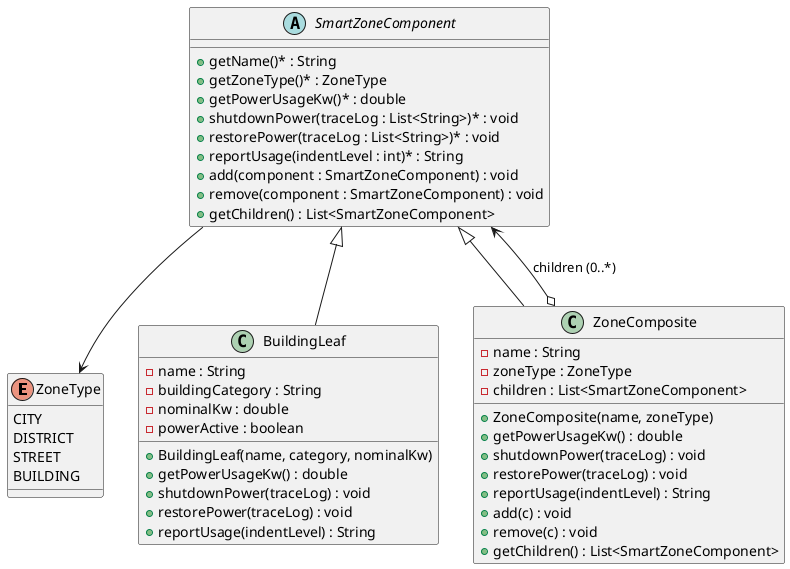
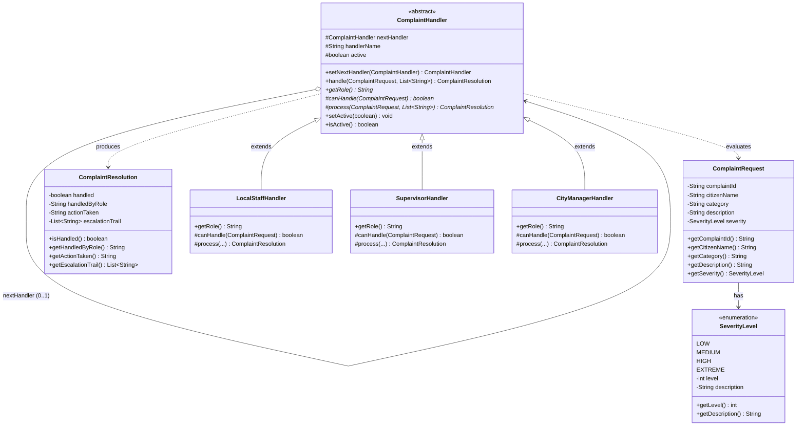
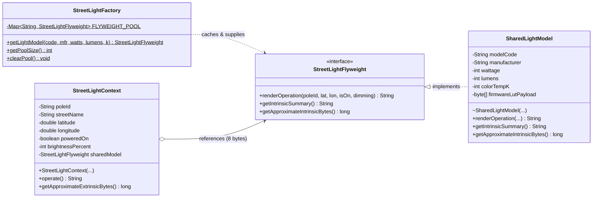
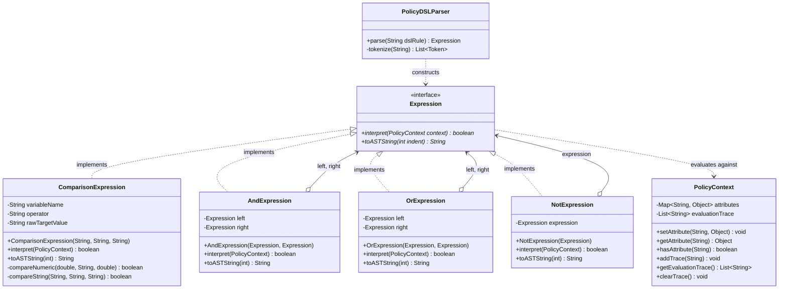

# SmartCity360 – Standalone UML Class Diagrams
## Complete Mermaid.js & PlantUML Specifications

This document contains standalone, publication-ready UML diagrams for all five Gang of Four design patterns and the Master Integrated System Architecture in both **Mermaid.js** and **PlantUML**.

---

## 1. Part A: Decorator Pattern (Data Stream Security)

### Mermaid Diagram

### PlantUML

---

## 2. Part B: Composite Pattern (Smart Zone Power Tree)

### Mermaid Diagram

### PlantUML

---

## 3. Part C: Chain of Responsibility Pattern (Complaint Escalation)

### Mermaid Diagram

---

## 4. Part D: Flyweight Pattern (Streetlight Memory Optimization)

### Mermaid Diagram

---

## 5. Part E: Interpreter Pattern (Policy DSL Evaluator)

### Mermaid Diagram

